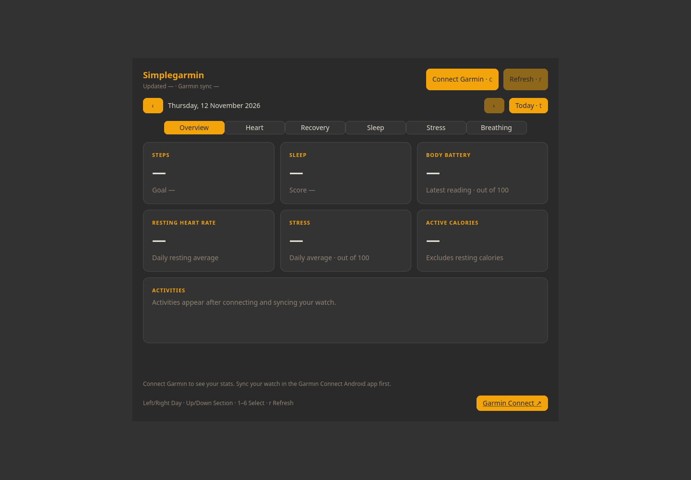
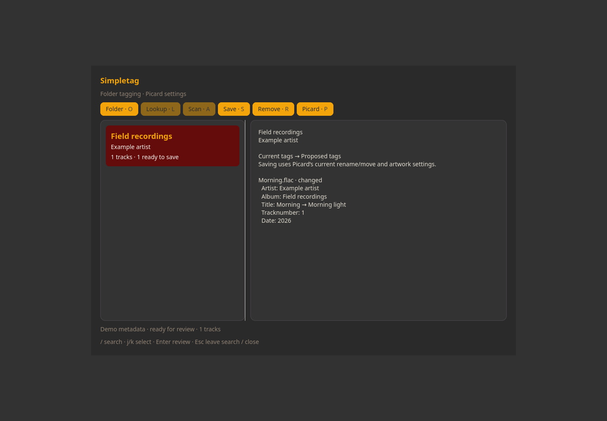

# Simple apps

Small Linux desktop applications with a shared visual style. Install the apps you want individually.

All apps support Vim-style key bindings, and almost every function can be used from the keyboard. See each app’s page for its shortcuts.

## One base, your choice of apps

Install one app or several. The installer brings in the shared C framework on the
first GTK app install and reuses it for subsequent apps. There is one installed
library, not a copy inside each app, and no background framework process.
Uninstalling an app keeps shared files needed by others; removing the final
consumer removes the unmodified runtime. Settings and maintained sources remain.

## Apps and screenshots

Click a screenshot or app name for features, installation and keyboard controls.

| [Simplelock](docs/simplelock.md) | [Simplewallpaper](docs/simplewallpaper.md) |
| :---: | :---: |
| [](docs/simplelock.md) | [](docs/simplewallpaper.md) |
| Wayland session lock with music and calendar | Static and sunrise-aware Wayland wallpaper |

| [SimplePhoto](docs/simplephoto.md) | [Simpleplayer](docs/simpleplayer.md) |
| :---: | :---: |
| [](docs/simplephoto.md) | [](docs/simpleplayer.md) |
| Photo adjustments, cropping and Vim-style controls | Music library, artwork and mpv playback |

| [Simplecalendar](docs/simplecalendar.md) | [Simplepicker](docs/simplepicker.md) |
| :---: | :---: |
| [](docs/simplecalendar.md) | [](docs/simplepicker.md) |
| Calendar, recurring events and CalDAV sync | Application launcher, search and keyboard menus |

| [System dashboard](docs/simplepanel.md) | [Simplepanel](docs/simplepanel.md) |
| :---: | :---: |
| [](docs/simplepanel.md) | [](docs/simplepanel.md) |
| System resources, world clocks and market prices | Compact desktop status panel |

| [Simplemail](docs/simplemail.md) | [Simplecontacts](docs/simplecontacts.md) |
| :---: | :---: |
| [](docs/simplemail.md) | [](docs/simplecontacts.md) |
| Native IMAP/SMTP mail and account setup | Google contacts with an offline local copy |

| [Simpletorrent](docs/simpletorrent.md) | [Simple tools](docs/simple-tools.md) |
| :---: | :---: |
| [](docs/simpletorrent.md) | [](docs/simple-tools.md) |
| Transmission download controls | Sound, network, disks, displays and services |

| [Simpleimage](docs/simpleimage.md) | [Simplepdf](docs/simplepdf.md) |
| :---: | :---: |
| [](docs/simpleimage.md) | [](docs/simplepdf.md) |
| Image viewing, thumbnails, printing and Simplephoto editing | PDF reading, search, bookmarks and export tools |

| [Simplefiles](docs/simplefiles.md) | [Simplenotes](docs/simplenotes.md) |
| :---: | :---: |
| [](docs/simplefiles.md) | [](docs/simplenotes.md) |
| Portable file picker with previews and Vim keys | Plain-text notes with instant search and autosave |

| [Simpleclip](docs/simpleclip.md) | [Simplecapture](docs/simplecapture.md) |
| :---: | :---: |
| [](docs/simpleclip.md) | [](docs/simplecapture.md) |
| Searchable cliphist history with previews | Screenshots, annotation and optional screen recording |

| [Simpletimer](docs/simpletimer.md) | [Simplebookmarks](docs/simplebookmarks.md) |
| :---: | :---: |
| [](docs/simpletimer.md) | [](docs/simplebookmarks.md) |
| Countdown, stopwatch, Pomodoro, fasting and meditation with soft bells | Search, open and manage bookmarks with Vim keys |

| [Simplegarmin](simplegarmin/README.md) | [Simpletag](simpletag/README.md) |
| :---: | :---: |
| [](simplegarmin/README.md) | [](simpletag/README.md) |
| Garmin health and activity overview | Picard music metadata review and tagging |

Screenshots use an isolated demo profile with sample content.

## Portable builds

For direct builds on Debian 13 or Arch, dependency lists, optional helpers, and
custom installation prefixes, see [Portable builds](docs/portability.md).

## Install from this checkout

The source installer supports **Linux with Python 3.11+ and preinstalled dependencies** using `--no-packages`. Automatic package installation remains Arch/pacman-only. GTK apps can run on other desktops; wallpaper, panel and lock features need the Wayland protocols listed on their app pages.

```sh
./install --plan simpleplayer
./install --install simpleplayer
```

Run as your normal user; package installation uses sudo. The installer builds sources locally. Commands go into `~/.local/bin`; add that directory to PATH if needed. Installation does not replace your desktop or enable services, account sync, autostart or key bindings.

```sh
./install --uninstall simpleplayer
```

Uninstallation retains settings, personal data, modified files and shared resources used by remaining apps. System packages and source copies are retained.

## Debian 13 and other distributions

Install the compiler, GTK4 headers and Python GTK bindings first, then use the
source installer with `--no-packages`:

```sh
sudo apt update
sudo apt install git build-essential pkg-config python3 python3-gi \
  python3-gi-cairo python3-cairo libgtk-4-dev gir1.2-gtk-4.0 \
  libglib2.0-dev xdg-utils libnotify-bin
git clone https://github.com/se7en-x230/simpleapps.git
cd simpleapps
./install --check simpletimer simplenotes
./install --no-packages --install simpletimer simplenotes
export PATH="$HOME/.local/bin:$PATH"
```

[The full Linux build guide](docs/portability.md) covers Debian dependencies for
other apps, Arch/Artix, direct Makefile builds, custom prefixes and package
staging on other distributions. GTK >= 4.12 is required; stock Debian 12 is too
old. Simplelock additionally needs gtk4-layer-shell >= 1.2, newer than Debian
13's stock package. Automatic package installation remains pacman-only.

## Individual installer archives

Create a portable source installer for one app:

```sh
mkdir -p releases
./install --bundle releases/simpleplayer-installer.tar.gz --bundle-app simpleplayer
```

The archive includes required shared code, `install` and `uninstall`. Generated release archives are excluded from Git. Wallpaper theme packs are optional and separate; this checkout includes no large theme collection. You can use your own wallpaper images. See [Simplewallpaper](docs/simplewallpaper.md).

## How the apps are built

These are native Linux desktop apps, primarily using GTK, with C and Python implementations. Python apps use PyGObject to access GTK; C components call native libraries directly. Simpleclip combines a Python launcher with the shared C clipboard interface. Simplecapture combines Python and a shell recording helper.

Established libraries and tools handle the heavy work: Poppler renders PDFs, GdkPixbuf loads images, Pillow/NumPy process photos, mpv plays media, and grim/Swappy/wf-recorder handle capture. Dependencies vary by app; installing one does not require the whole suite.

Apps share the C `libsimple-ui` base for theme loading and native keyboard handling. Python UI code uses a thin native adapter. App-specific layouts, navigation commands and data formats remain local; headless backends use the shared picker for optional menus. Runtime settings live under XDG config directories, normally `~/.config`; installed source snapshots live under `~/.local/src`. See each app’s page for its settings and portability limits.

The shared GTK presentation uses orange upper-left titles, rounded pane cards, alternating gray list rows, orange action buttons and slim tabs with an orange active state. Shortcut suffixes on buttons use `simple_shortcut` (dark gray); set it with the other palette colors in `~/.config/simple/theme.css`. Pane framing and shortcut styling are applied by the shared library, including dynamically created controls.

## Build without a distribution-specific package installer

```sh
./install --dependencies simplepicker
./install --check simplepicker
./install --no-packages --install simplepicker
```

Use `--install APP --stage DIRECTORY` to build into an empty staging directory
without installing packages or modifying personal configuration. Each app README
lists its libraries, Python imports, helper commands and desktop requirements.

## Source layout

Each app has its own directory. `simple-common` holds shared code and small fallback images. `simpleinstaller` contains package recipes, default configuration and uninstall tracking. Keep sibling source directories together when building manually; individual archives include the siblings they require.

Existing component README files describe developer details and may mention shortcuts from the original desktop setup. Those shortcuts are not assigned by installation.

## Licensing

All original Simpleapps tools and shared code are **GPL-3.0-or-later**: GNU General Public License version 3, or (at your option) any later version.

See [COPYING](COPYING) for the license grant and third-party exceptions, and [LICENSE](LICENSE) for the full GPL text. Existing third-party copyright and license notices remain intact.

See [keyboard controls](docs/keyboard.md) for focus navigation and app-specific shortcuts.

[Simpletag](simpletag/README.md) provides folder lookup, audio scanning, tag review
and save/remove controls over Picard 3, using the shared framework and Simplefiles.
