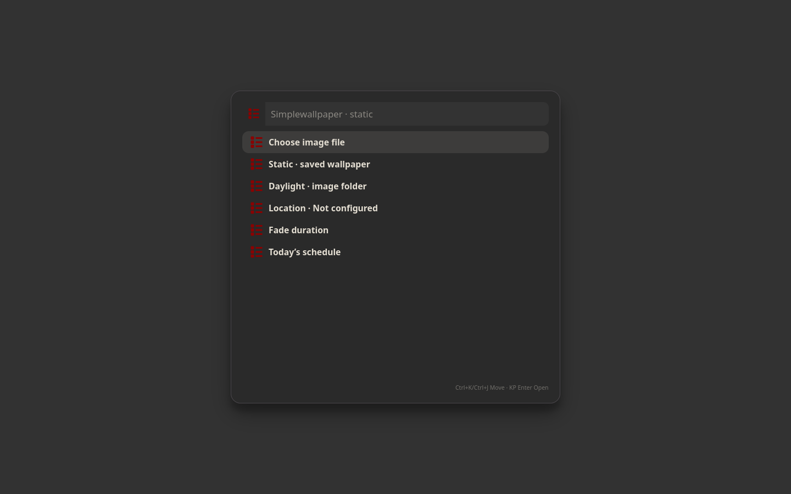

# Simple apps

Small Linux desktop applications with a shared visual style. Install the apps you want individually.

All apps support Vim-style key bindings, and almost every function can be used from the keyboard. See each app’s page for its shortcuts.

## Apps and screenshots

Click a screenshot or app name for features, installation and keyboard controls.

| [SimplePhoto](docs/simplephoto.md) | [Simpleplayer](docs/simpleplayer.md) |
| :---: | :---: |
| [](docs/simplephoto.md) | [](docs/simpleplayer.md) |
| Photo adjustments, cropping and Vim-style controls | Music library, artwork and mpv playback |

| [Simplecalendar](docs/simplecalendar.md) | [Simplepicker](docs/simplepicker.md) |
| :---: | :---: |
| [](docs/simplecalendar.md) | [](docs/simplepicker.md) |
| Calendar, recurring events and CalDAV sync | Application launcher, search and keyboard menus |

| [System dashboard](docs/simplepanel.md) | [Simplepanel](docs/simplepanel.md) |
| :---: | :---: |
| [](docs/simplepanel.md) | [](docs/simplepanel.md) |
| System resources, world clocks and market prices | Compact desktop status panel |

| [Simplemail](docs/simplemail.md) | [Simplecontacts](docs/simplecontacts.md) |
| :---: | :---: |
| [](docs/simplemail.md) | [](docs/simplecontacts.md) |
| Native IMAP/SMTP mail and account setup | Google contacts with an offline local copy |

| [Simpletorrent](docs/simpletorrent.md) | [Simple tools](docs/simple-tools.md) |
| :---: | :---: |
| [](docs/simpletorrent.md) | [](docs/simple-tools.md) |
| Transmission download controls | Sound, network, disks, displays and services |

| [Simplewallpaper](docs/simplewallpaper.md) | [Simplelock](docs/simplelock.md) |
| :---: | :---: |
| [](docs/simplewallpaper.md) | [](docs/simplelock.md) |
| Static and sunrise-aware Wayland wallpaper | Wayland session lock with music and calendar |

## Install from this checkout

The installer currently supports **Arch-based Linux with Python 3 and pacman**. GTK apps can run on other desktops; wallpaper, panel and lock features need the Wayland protocols listed on their app pages.

```sh
./install --plan simpleplayer
./install --install simpleplayer
```

Run as your normal user; package installation uses sudo. The installer builds sources locally. Commands go into `~/.local/bin`; add that directory to PATH if needed. Installation does not replace your desktop or enable services, account sync, autostart or key bindings.

```sh
./install --uninstall simpleplayer
```

Uninstallation retains settings, personal data, modified files and shared resources used by remaining apps. System packages and source copies are retained.

## Individual installer archives

Create a portable source installer for one app:

```sh
mkdir -p releases
./install --bundle releases/simpleplayer-installer.tar.gz --bundle-app simpleplayer
```

The archive includes required shared code, `install` and `uninstall`. Generated release archives are excluded from Git. Wallpaper theme packs are optional and separate; this checkout includes no large theme collection. You can use your own wallpaper images. See [Simplewallpaper](docs/simplewallpaper.md).

## Source layout

Each app has its own directory. `simple-common` holds shared code and small fallback images. `simpleinstaller` contains package recipes, default configuration and uninstall tracking. Keep sibling source directories together when building manually; individual archives include the siblings they require.

Existing component README files describe developer details and may mention shortcuts from the original desktop setup. Those shortcuts are not assigned by installation.

## Licensing

Existing third-party copyright and license notices are retained in the source files. A project-wide distribution license has not yet been selected.
