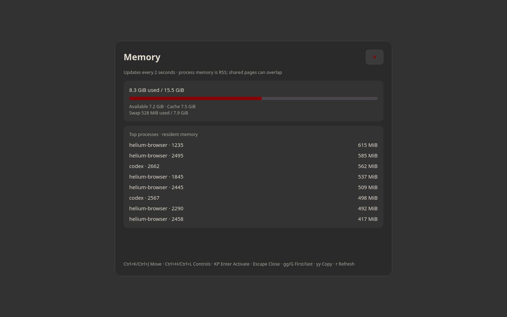

# Simple tools

Open individual controls for sound, network/Bluetooth, disk usage, CPU, memory, displays and services. Controls use the services already available on your system; the shared Picker menu engine is included.



Screenshot captured in an isolated profile; no personal accounts are connected.

## Install and start

From the repository root on an Arch-based system:

```sh
./install --install simple-tools
simple-sound
```

Or extract the individual `simple-tools-installer-YYYYMMDD.tar.gz` release archive and run `./install` inside it. Run as your normal user. Add `$HOME/.local/bin` to PATH if your desktop has not already done so.

**Compatibility:** Sound: PulseAudio/PipeWire; network: NetworkManager; displays: wlr-output-management; services: systemd/dinit..

Uses your existing audio/network/service managers. Nothing is enabled or switched automatically; unsupported controls report the missing capability. The shared Picker menu engine is included; the Picker launcher itself is optional.

## Remove

```sh
./install --uninstall simple-tools
```

An individual installer also provides `./uninstall`. Uninstallation preserves personal settings/data, changed files, system packages and shared files still needed by other apps.

## Code

[Source directory](../simple-tools/) · [Dependency and option catalog](../simpleinstaller/components.json) · [All apps](../README.md)

Runtime packages: `python`, `python-gobject`, `gtk4`, `libpulse`, `networkmanager`, `bluez-utils`, `util-linux`, `wlr-randr`, `wl-clipboard`, `libnotify`, `sudo`, `gtk4-layer-shell`, `json-c`, `iproute2`.

The screenshot shows the memory tool with live resource usage.
