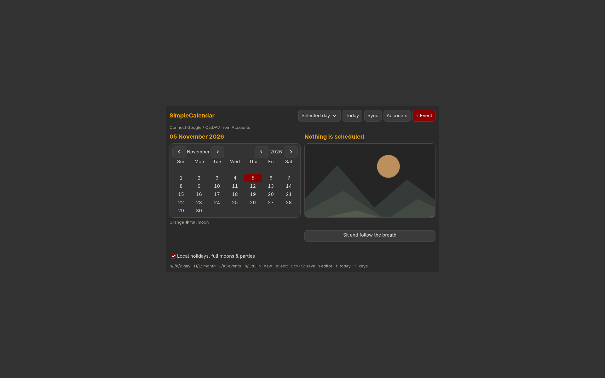

# Simplecalendar

View and edit calendar events, including recurring events. Connect your own CalDAV or Google account when needed; background reminders require explicitly starting the watcher.



Screenshot captured in an isolated profile; no personal accounts are connected.

## Install and start

From the repository root on an Arch-based system:

```sh
./install --install simplecalendar
simple-calendar
```

Or extract the individual `simplecalendar-installer-YYYYMMDD.tar.gz` release archive and run `./install` inside it. Run as your normal user. Add `$HOME/.local/bin` to PATH if your desktop has not already done so.

**Compatibility:** GTK desktop.

Connect your own account from Accounts. Run simple-calendar --watch for background reminders and sync; no account or service is enabled by installation.

## Remove

```sh
./install --uninstall simplecalendar
```

An individual installer also provides `./uninstall`. Uninstallation preserves personal settings/data, changed files, system packages and shared files still needed by other apps.

## Code

[Source directory](../simplecalendar/) · [Dependency and option catalog](../simpleinstaller/components.json) · [All apps](../README.md)

Runtime packages: `gtk4`, `json-c`, `python`, `python-icalendar`, `python-recurring-ical-events`, `python-requests`, `vdirsyncer`, `libnotify`, `xdg-utils`.

## Optional 90-day report

The report button and special red marker are hidden by default. Launch with:

```sh
simple-calendar --show-90-day-report
```

The flag also applies when a calendar window is already open. Launching without it hides the report controls again. Existing report events remain ordinary calendar events; no data or reminders are deleted.
