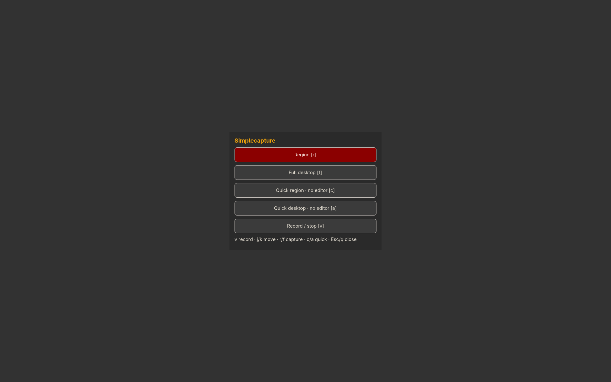

# Simplecapture

Screenshots, annotation and optional screen recording.



```sh
./install --install simplecapture
simplecapture --menu
./install --uninstall simplecapture
```

See [features, configuration, dependencies and keyboard controls](../simplecapture/README.md).


For integration with Simpleslideshow, `simplecapture --region --edit --save --no-copy --print-path` captures and annotates a title image, then prints its saved filename. Cancellation prints no filename.
