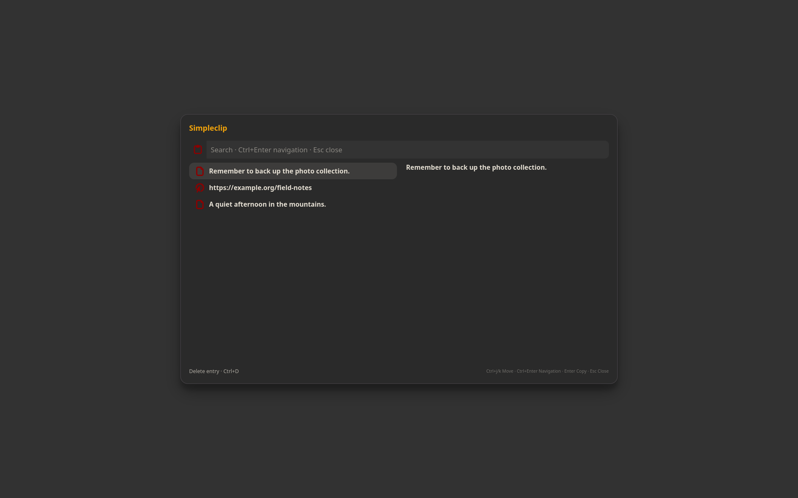

# Simpleclip

Searchable cliphist history with previews.



```sh
./install --install simpleclip
simpleclip
./install --uninstall simpleclip
```

See [features, configuration, dependencies and keyboard controls](../simpleclip/README.md).

