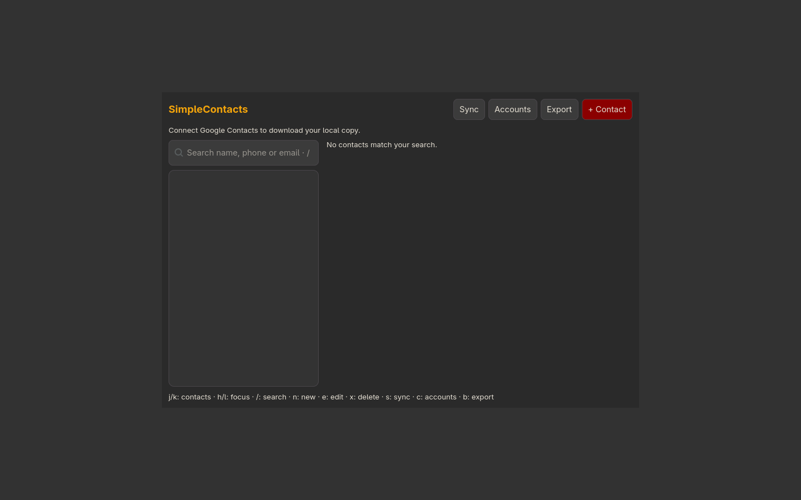

# Simplecontacts

Browse and edit a local copy of Google contacts. Online synchronization requires your own Google Desktop OAuth client and account.



Screenshot captured in an isolated profile; no personal accounts are connected.

## Install and start

From the repository root on an Arch-based system:

```sh
./install --install simplecontacts
simplecontacts
```

Or extract the individual `simplecontacts-installer-YYYYMMDD.tar.gz` release archive and run `./install` inside it. Run as your normal user. Add `$HOME/.local/bin` to PATH if your desktop has not already done so.

**Compatibility:** GTK desktop.

Connect your own Google account using a Desktop OAuth client JSON. No credentials are bundled.

## Remove

```sh
./install --uninstall simplecontacts
```

An individual installer also provides `./uninstall`. Uninstallation preserves personal settings/data, changed files, system packages and shared files still needed by other apps.

## Code

[Source directory](../simplecontacts/) · [Dependency and option catalog](../simpleinstaller/components.json) · [All apps](../README.md)

Runtime packages: `gtk4`, `json-c`, `python`, `python-google-auth`, `python-requests`, `xdg-utils`, `wl-clipboard`.
