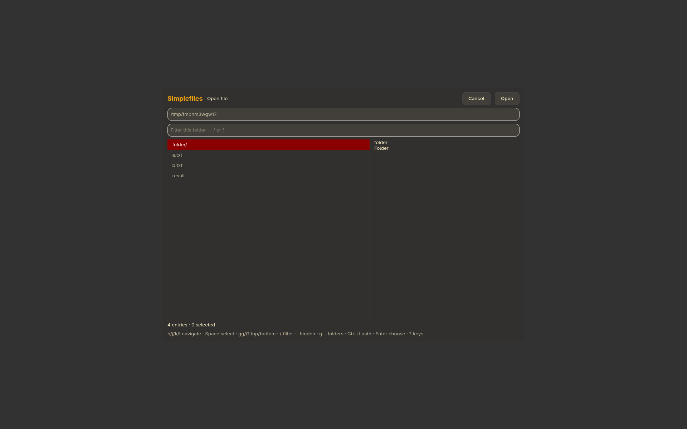

# Simplefiles

Portable file picker with previews and Vim keys.



```sh
./install --install simplefiles
simplefiles
./install --uninstall simplefiles
```

See [features, configuration, dependencies and keyboard controls](../simplefiles/README.md).

