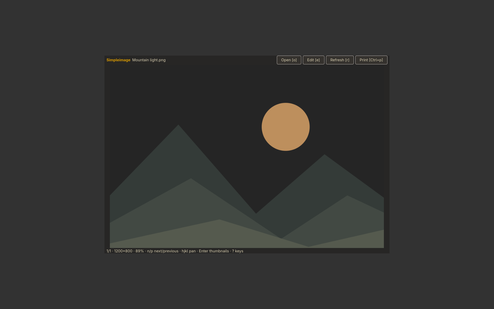

# Simpleimage

Image viewing, thumbnails, printing and Simplephoto editing.



```sh
./install --install simpleimage
simpleimage
./install --uninstall simpleimage
```

See [features, configuration, dependencies and keyboard controls](../simpleimage/README.md).

Opening Simplephoto with **e** automatically refreshes the viewer and selects each saved copy. **Enter** switches image/thumbnail view; **z** toggles thumbnail size; **Ctrl+p** prints.
