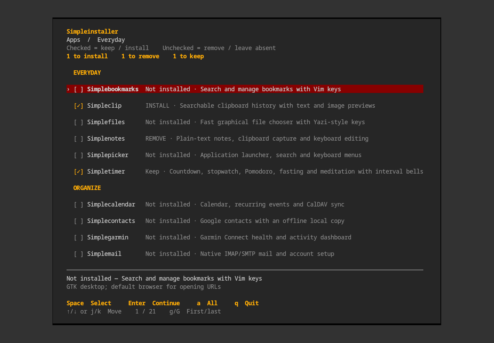

# Simpleinstaller

Install and remove Simpleapps from one grouped, alphabetically sorted menu. The shared framework is included automatically; there is no separate installer installation step.



*Demo selections: Simpleclip will install, Simplenotes will uninstall, and Simpletimer will stay installed. This screenshot does not show changes applied to a real installation.*

## Open the menu

From your downloaded or cloned `simpleapps` folder:

```sh
./install
```

On Debian and other distributions, [install the dependencies first](portability.md), then open the same menu with:

```sh
./install --no-packages
```

For the standalone installer archive, run `./simpleinstaller` inside its extracted directory instead.

Installed commands go into `~/.local/bin`. Follow the
[PATH setup instructions](../README.md#put-installed-commands-on-path) to run them
by name from your terminal; desktop-menu launchers work without this step.

## Choose the apps you want to keep

Apps tracked by the installer start checked. The checkboxes describe the installation you want after applying the changes.

| Change | Result |
| --- | --- |
| Leave an installed app checked | Keep it; no rebuild |
| Check an app that is not installed | Install it |
| Uncheck an installed app | Uninstall it |
| Leave an absent app unchecked | Do nothing |

Use **↑/↓ or j/k** to move, **Space** to toggle, **a** to toggle all, **Enter** to review, and **q** to cancel. Group headings are skipped by keyboard navigation. The counters show how many apps will install, uninstall, and stay installed. Leaving the selection unchanged makes no changes.

The installer shows the proposed actions before asking for confirmation. New apps install first; if that installation fails or is cancelled, requested removals do not proceed. Removing an app retains settings, personal data, modified files, and shared files still needed by other apps. System packages are also retained.

Detection uses Simpleinstaller's installation records. An older or manually installed app needs one explicit `./install --install APP` to register its files. To update or repair an already tracked app, also use `./install --install APP`; leaving it checked does not update it. Add `--no-packages` when supplying dependencies yourself.

[Full installer documentation](../simpleinstaller/README.md) · [Debian and other Linux build instructions](portability.md)
