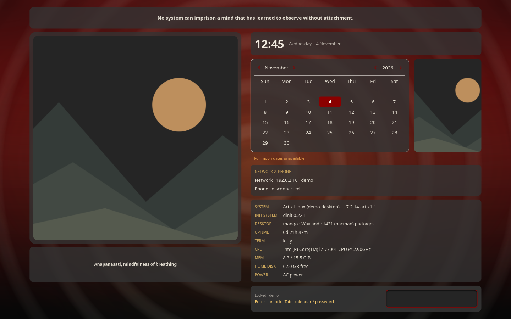

# Simplelock

Lock a compatible Wayland session, with music and calendar information on the lock screen. Uses an existing PAM service for authentication. Check configuration before assigning a lock shortcut.



Screenshot captured in an isolated profile; no personal accounts are connected.

## Install and start

From the repository root on an Arch-based system:

```sh
./install --install simplelock
simplelock
```

Or extract the individual `simplelock-installer-YYYYMMDD.tar.gz` release archive and run `./install` inside it. Run as your normal user. Add `$HOME/.local/bin` to PATH if your desktop has not already done so.

**Compatibility:** Wayland ext-session-lock-v1 and layer-shell; not X11 or KDE Plasma lock replacement..

Run simplelock --check-config first. Uses the existing login PAM service; choose a suitable service in config.toml if needed. The installer never activates locking or edits PAM.

## Remove

```sh
./install --uninstall simplelock
```

An individual installer also provides `./uninstall`. Uninstallation preserves personal settings/data, changed files, system packages and shared files still needed by other apps.

## Code

[Source directory](../simplelock/) · [Dependency and option catalog](../simpleinstaller/components.json) · [All apps](../README.md)

Runtime packages: `gtk4`, `json-c`, `gtk4-layer-shell`, `pam`.

Screenshot uses demo hostname and network labels in a temporary preview build. The distributed source reads real system information.
