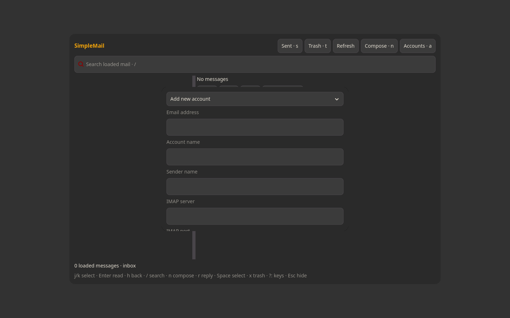

# Simplemail

Read and compose email using IMAP and SMTP. Includes account setup and optional KeePassXC integration. Add an account before using mail.



Screenshot captured in an isolated profile; no personal accounts are connected.

## Install and start

From the repository root on an Arch-based system:

```sh
./install --install simplemail
simplemail
```

Or extract the individual `simplemail-installer-YYYYMMDD.tar.gz` release archive and run `./install` inside it. Run as your normal user. Add `$HOME/.local/bin` to PATH if your desktop has not already done so.

**Compatibility:** GTK desktop.

Add your own mail account with simplemail --setup. Installation does not connect, sync or send mail.

## Remove

```sh
./install --uninstall simplemail
```

An individual installer also provides `./uninstall`. Uninstallation preserves personal settings/data, changed files, system packages and shared files still needed by other apps.

## Code

[Source directory](../simplemail/) · [Dependency and option catalog](../simpleinstaller/components.json) · [All apps](../README.md)

Runtime packages: `gtk4`, `json-c`, `python`, `python-gobject`, `python-cryptography`, `xdg-utils`, `libnotify`.
