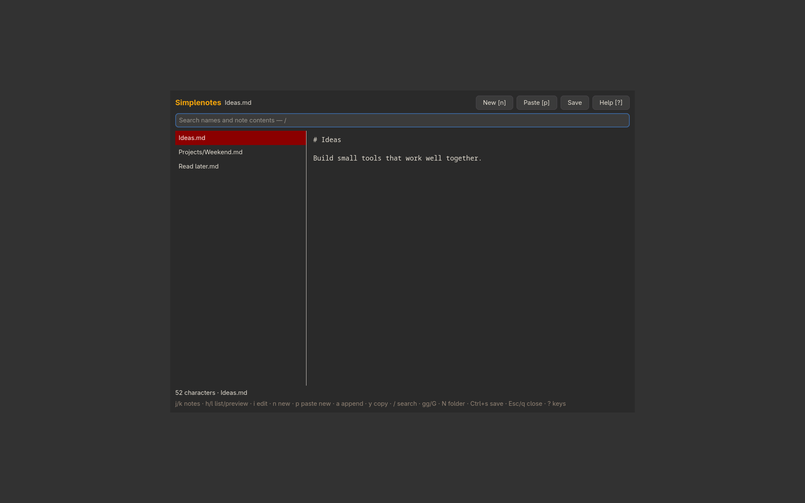

# Simplenotes

Plain-text notes with instant search and autosave.



```sh
./install --install simplenotes
simplenotes
./install --uninstall simplenotes
```

See [features, configuration, dependencies and keyboard controls](../simplenotes/README.md).

