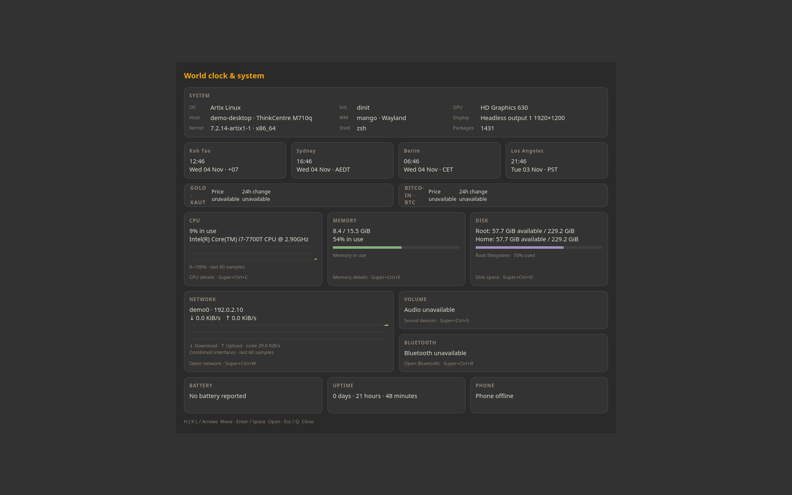

# Simplepanel

Show a desktop status panel or open the system dashboard. The panel includes desktop and media information; workspace/title integration currently targets Mango. Start the panel explicitly with simplepanel-session.



Screenshot captured in an isolated profile; no personal accounts are connected.

## Install and start

From the repository root on an Arch-based system:

```sh
./install --install simplepanel
simplepanel --system-dashboard
```

Or extract the individual `simplepanel-installer-YYYYMMDD.tar.gz` release archive and run `./install` inside it. Run as your normal user. Add `$HOME/.local/bin` to PATH if your desktop has not already done so.

**Compatibility:** Panel: Wayland layer-shell; workspace/title integration: Mango. Dashboard: normal GTK window..

Application menu opens the system dashboard. Start simplepanel-session explicitly for the panel; no existing panel is replaced.

## Remove

```sh
./install --uninstall simplepanel
```

An individual installer also provides `./uninstall`. Uninstallation preserves personal settings/data, changed files, system packages and shared files still needed by other apps.

## Code

[Source directory](../simplepanel/) · [Dependency and option catalog](../simpleinstaller/components.json) · [All apps](../README.md)

Runtime packages: `gtk4`, `json-c`, `python`, `gtk4-layer-shell`, `libpulse`, `fastfetch`.

Screenshot uses demo hostname and network labels in a temporary preview build. The distributed source reads real system information.
