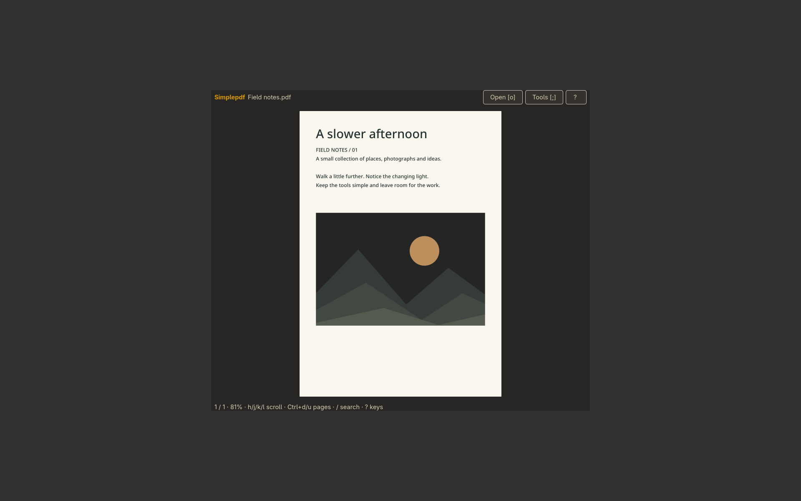

# Simplepdf

PDF reading, search, bookmarks and export tools.



```sh
./install --install simplepdf
simplepdf
./install --uninstall simplepdf
```

See [features, configuration, dependencies and keyboard controls](../simplepdf/README.md).


`t` opens the table of contents. `Tab` / `Shift+Tab` moves between controls;
`Enter` or `Space` activates the focused button.
