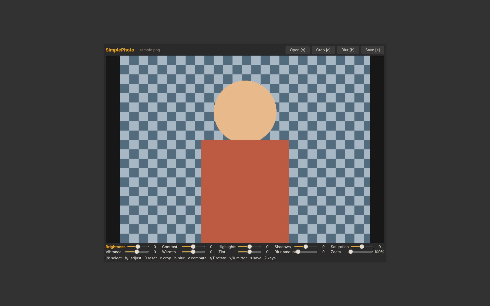
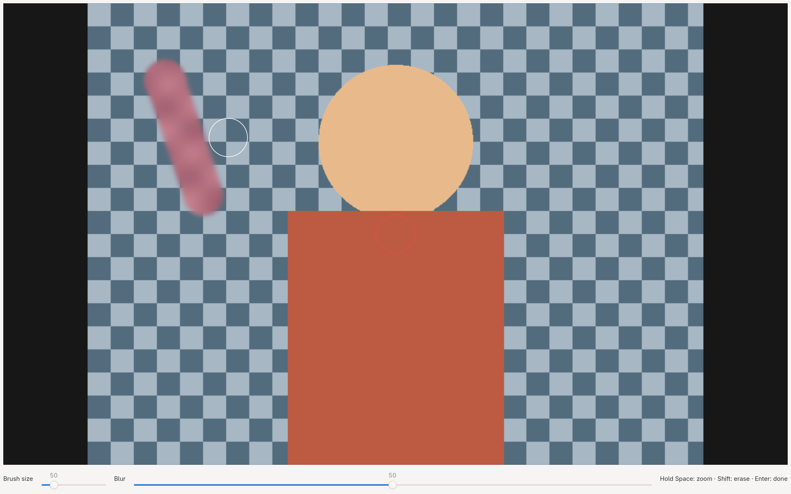

# SimplePhoto

Quick local photo edits with compact controls and a large image preview. Adjust brightness, contrast, highlights, shadows, saturation, vibrance, warmth and tint; crop in the same window and save a separate numbered copy.



```sh
./install --install simplephoto
simplephoto
simplephoto picture.jpg
simplephoto --crop picture.jpg
./install --uninstall simplephoto
```

Works on GTK desktops under Wayland or X11; no Mango, Yazi, nsxiv or Google account required. The installer currently handles packages on Arch-based distributions. Python, GTK4/PyGObject, Cairo, Pillow and NumPy are required.

Use `j/k` to select a control, `h/l` to adjust, `v` for original/edited, `c` for crop, `s` to save and `?` for all shortcuts. Editing sliders start at zero, retaining the original camera look as the baseline; Zoom starts at 100% fit. Colour profiles are converted to sRGB. Exports are SDR stills and do not retain HDR gain maps or Motion Photo video.

See [controls and export details](../simplephoto/README.md).

Press `b` for the fullscreen manual blur brush. Paint areas to blur; hold Shift to deselect. Hold Space for 3× zoom at the pointer. Only brush size and blur strength are shown. `[` / `]` changes size, `m` toggles the overlay, `u` undoes, and Enter returns to the editor. Press `v` to compare original and edited. AI detection is not included.



The main editor has two rows of five sliders, including view-only Zoom (100–400% of fit). Drag to pan when zoomed. Crop and blur each hide the adjustment controls and show their own key-help line.

Use the rotation and mirror shortcuts in the bottom guide: `t`/`Shift+t` rotate right/left; `x`/`Shift+x` mirror left/right or top/bottom.
