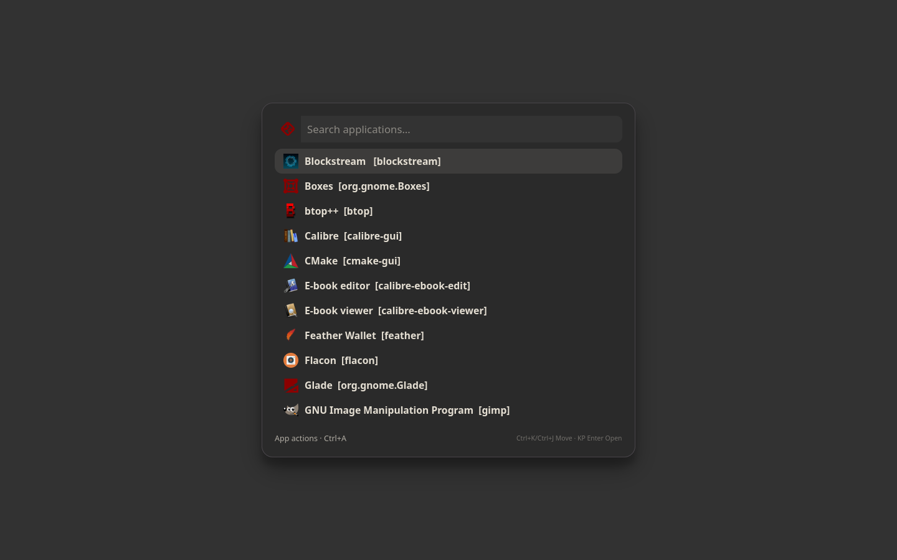

# Simplepicker

Launch applications and navigate searchable keyboard menus. Useful for a desktop launcher or a menu called from your own shortcuts.



Screenshot captured in an isolated profile; no personal accounts are connected.

## Install and start

From the repository root on an Arch-based system:

```sh
./install --install simplepicker
simplepicker
```

Or extract the individual `simplepicker-installer-YYYYMMDD.tar.gz` release archive and run `./install` inside it. Run as your normal user. Add `$HOME/.local/bin` to PATH if your desktop has not already done so.

**Compatibility:** GTK window; Wayland layer-shell when available.

Installation does not configure desktop shortcuts or autostart.

## Remove

```sh
./install --uninstall simplepicker
```

An individual installer also provides `./uninstall`. Uninstallation preserves personal settings/data, changed files, system packages and shared files still needed by other apps.

## Code

[Source directory](../simplepicker/) · [Dependency and option catalog](../simpleinstaller/components.json) · [All apps](../README.md)

Runtime packages: `gtk4`, `gtk4-layer-shell`, `json-c`, `python`, `xdg-utils`, `wl-clipboard`.
