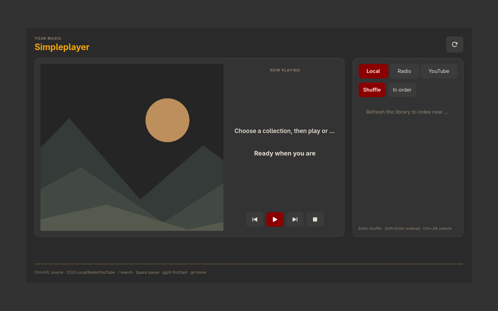

# Simpleplayer

Browse a local music library, display album art and control mpv playback. Optional radio, YouTube search and Cava visualization are available. Music stays playing when the window closes.



Screenshot captured in an isolated profile; no personal accounts are connected.

## Install and start

From the repository root on an Arch-based system:

```sh
./install --install simpleplayer
simpleplayer
```

Or extract the individual `simpleplayer-installer-YYYYMMDD.tar.gz` release archive and run `./install` inside it. Run as your normal user. Add `$HOME/.local/bin` to PATH if your desktop has not already done so.

**Compatibility:** GTK desktop; PulseAudio/PipeWire for optional Cava.

Installation does not configure desktop shortcuts or autostart.

## Remove

```sh
./install --uninstall simpleplayer
```

An individual installer also provides `./uninstall`. Uninstallation preserves personal settings/data, changed files, system packages and shared files still needed by other apps.

## Code

[Source directory](../simpleplayer/) · [Dependency and option catalog](../simpleinstaller/components.json) · [All apps](../README.md)

Runtime packages: `gtk4`, `json-c`, `python`, `mpv`, `util-linux`, `ffmpeg`, `xdg-utils`, `bash`, `coreutils`, `findutils`.
