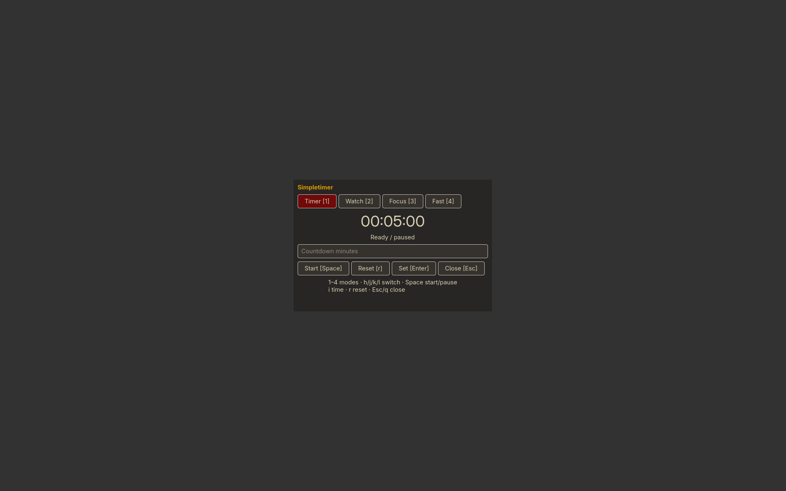

# Simpletimer

Countdown, stopwatch, Pomodoro, fasting and meditation timer.

**Meditate [5]**: choose a duration or **0 for open end**. Soft bells mark the start,
each 10 minutes and the finish. **m** mutes waypoint bells; **f** finishes the session.

[Start/end bell](audio/meditation-begin-end.wav) · [Waypoint bell](audio/meditation-waypoint.wav)



```sh
./install --install simpletimer
simpletimer
./install --uninstall simpletimer
```

See [features, configuration, dependencies and keyboard controls](../simpletimer/README.md).

