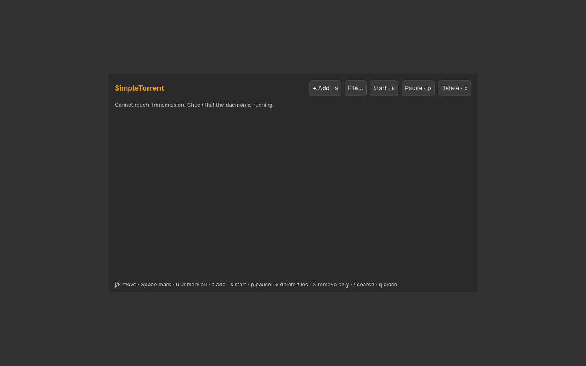

# Simpletorrent

Manage downloads through a running Transmission daemon. The interface does not replace the daemon. Authenticated RPC is not supported yet.



Screenshot captured in an isolated profile; no personal accounts are connected.

## Install and start

From the repository root on an Arch-based system:

```sh
./install --install simpletorrent
simpletorrent
```

Or extract the individual `simpletorrent-installer-YYYYMMDD.tar.gz` release archive and run `./install` inside it. Run as your normal user. Add `$HOME/.local/bin` to PATH if your desktop has not already done so.

**Compatibility:** GTK desktop.

Connect to your running local Transmission daemon. Start transmission-daemon separately if needed. Existing daemon settings and downloads are preserved; authenticated RPC is not supported yet.

## Remove

```sh
./install --uninstall simpletorrent
```

An individual installer also provides `./uninstall`. Uninstallation preserves personal settings/data, changed files, system packages and shared files still needed by other apps.

## Code

[Source directory](../simpletorrent/) · [Dependency and option catalog](../simpleinstaller/components.json) · [All apps](../README.md)

Runtime packages: `gtk4`, `json-c`, `curl`, `transmission-cli`.

The screenshot shows the disconnected state, before configuring a Transmission daemon.
