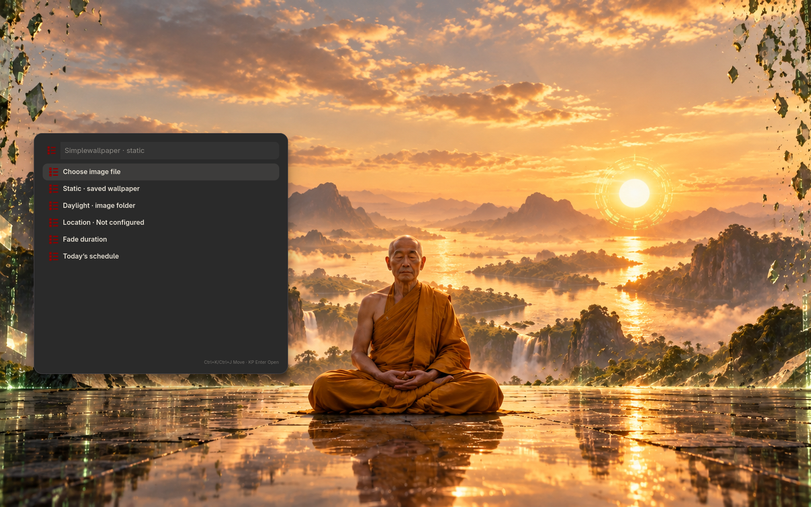

# Simplewallpaper

Choose a static wallpaper or a set of still images that changes with daylight. Configure your own location for sunrise/sunset scheduling. Optional theme packs are separate downloads; you can also use your own images.



Screenshot captured in an isolated profile; no personal accounts are connected.

## Install and start

From the repository root on an Arch-based system:

```sh
./install --install simplewallpaper
simplewallpaper
```

Or extract the individual `simplewallpaper-installer-YYYYMMDD.tar.gz` release archive and run `./install` inside it. Run as your normal user. Add `$HOME/.local/bin` to PATH if your desktop has not already done so.

**Compatibility:** Wayland layer-shell (not the Plasma desktop wallpaper).

Open Simplewallpaper; set your location before enabling daylight. Autostart is optional.

## Remove

```sh
./install --uninstall simplewallpaper
```

An individual installer also provides `./uninstall`. Uninstallation preserves personal settings/data, changed files, system packages and shared files still needed by other apps.

## Code

[Source directory](../simplewallpaper/) · [Dependency and option catalog](../simpleinstaller/components.json) · [All apps](../README.md)

Runtime packages: `python`, `awww`, `imagemagick`.
