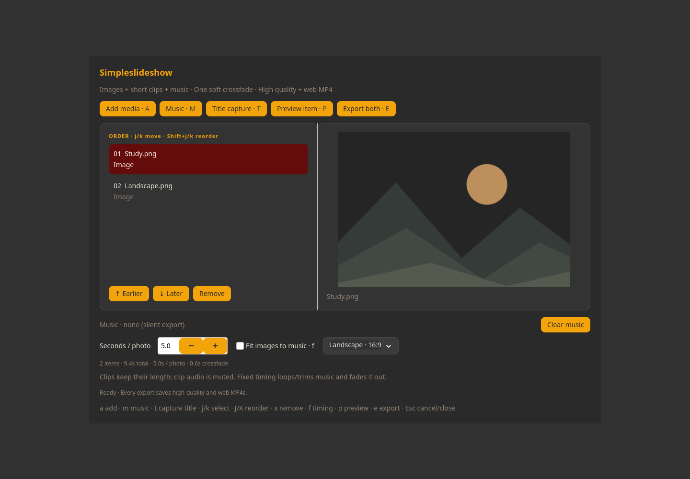

# Simpleslideshow

A small Vim-style GTK front end for **FFmpeg and ffprobe**. Make family slideshows from images, short video clips, and one music track. The interface uses the shared Simpleapps framework and theme.



## Workflow

1. **a** adds images and clips; j/k selects an item. **Shift+j/k** changes its position; **x** removes it from the list, never from disk.
2. **m** chooses music. Use **t** for a title image: Simplecapture runs grim/slurp and Swappy, then inserts the saved, annotated screenshot first. You can also add any prepared title image normally.
3. Choose landscape (16:9) or portrait (9:16), and either timing mode:
   - **Fit images to music:** share the remaining music time equally among still images. Video clips keep their duration. Crossfade overlap is included in the calculation. An impossible fit is reported before exporting.
   - **Fixed photo timing:** choose 1–60 seconds per image (default 4). Music loops if shorter, is trimmed if longer, and fades out over the final two seconds (or half the slideshow for very short exports).
4. **e** exports both versions with the same name: `NAME-high.mp4` and `NAME-web.mp4`.

| Export | Landscape | Portrait | Encoding |
| --- | --- | --- | --- |
| High quality | 1920 × 1080 | 1080 × 1920 | H.264 CRF 18, AAC 192 kb/s |
| Web | 1280 × 720 | 720 × 1280 | H.264 CRF 26, AAC 128 kb/s |

Both use 30 fps, widely supported 8-bit YUV 4:2:0, and MP4 fast-start metadata for web playback. Smaller sources may be enlarged. Images are fitted inside the frame with black padding, never cropped. Clip sound is muted; the selected music is the only audio. Without music, export is silent. Fit mode also has a short ending fade.

One soft crossfade is used throughout (0.6 seconds, reduced for very short items). There are no transition presets, effects, timeline, or background service. Rendering processes at most two source clips at a time to keep memory bounded. FFmpeg builds body/transition segments in a temporary directory before assembling the export.

Existing output files are never overwritten. Both versions are prepared before publication; cancellation or a failed save cleans up newly created output files. Originals are not modified. The media list and settings are saved automatically in `~/.local/state/simpleslideshow/draft.json`; reopening restores the draft. Referenced media must remain available. Temporary render files need sufficient local disk space.

## Keys

| Key | Action |
| --- | --- |
| a / Ctrl+O | Add media |
| m / Ctrl+M | Choose music |
| Ctrl+Shift+M | Clear music |
| t / Ctrl+T | Capture and annotate an intro image |
| j/k or arrows | Select an item |
| Shift+j/k | Move selected item later/earlier |
| x / Delete | Remove selected item |
| f | Toggle fit-to-music |
| p / Enter on list | Open selected source for preview |
| e / Ctrl+E | Export high and web versions |
| Esc | Cancel work, leave an editable control, or close |
| q | Close outside text editing |

Key overrides live in `~/.config/simpleslideshow/keys.ini`. Colors come from `~/.config/simple/theme.css`. Mouse controls and Tab navigation remain available.

## Install

From the suite checkout:

```sh
./install --plan simpleslideshow
./install --install simpleslideshow
simpleslideshow
```

Debian 13: install the [shared build/runtime requirements](../docs/portability.md), plus `ffmpeg`; then use `./install --no-packages --install simpleslideshow`. Install Simplecapture separately for title capture (`grim`, `slurp`, `swappy` on Wayland). Source previews use mpv when available for videos, otherwise the desktop default viewer.

Uninstall with `./install --uninstall simpleslideshow` (review the plan first with
`./install --uninstall simpleslideshow --dry-run`). See the suite uninstall documentation
for preserved settings and shared files.

## Checks and license

`python3 simpleslideshow/tests/check.py` checks timing, actual exports, crossfade pixels, audio fade, cancellation and no-overwrite behavior (Pillow is needed only for test images). FFmpeg filter references: [xfade](https://ffmpeg.org/ffmpeg-filters.html#xfade), [afade](https://ffmpeg.org/ffmpeg-filters.html#afade).

Original Simpleapps code is GPL-3.0-or-later. See the repository LICENSE and COPYING. FFmpeg and other external tools retain their own licenses.
